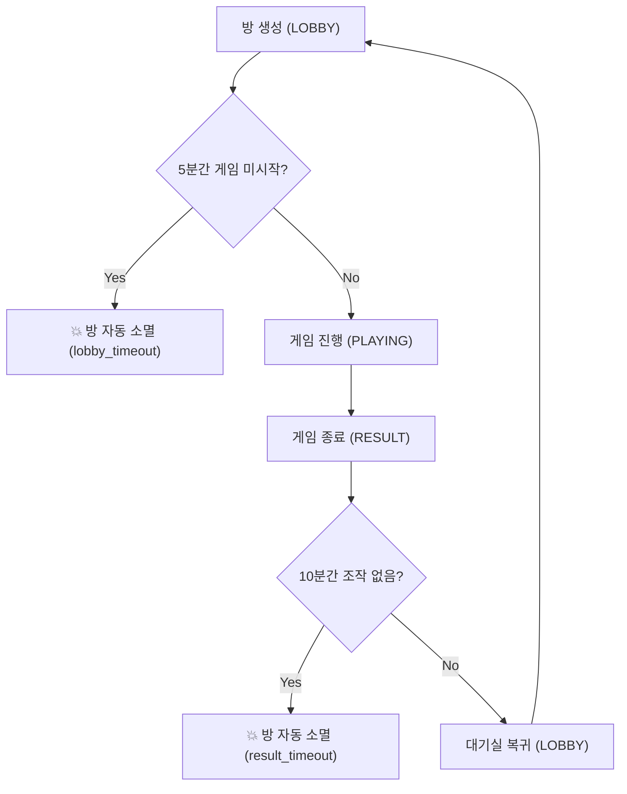

# 🧹 09. 2026-MiniGame 인메모리 자동 소멸(GC) 수명주기 동작 원리

> **작성 일시**: 2026-11-03  
> **프로젝트**: `2026-MiniGame`  
> **관련 파일**: [server/models/RoomManager.js](file:///d:/My%20Web%20App/2026-MiniGame/server/models/RoomManager.js), [server/models/Room.js](file:///d:/My%20Web%20App/2026-MiniGame/server/models/Room.js)

---

## 1. 탄생 배경: "DB 비용 0원 & 초경량 메모리 최적화"
`2026-MiniGame`은 별도의 데이터베이스(DB)나 외부 캐시 서버(Redis) 없이 **서버 메모리(In-Memory RAM)만으로 가볍고 빠르게 동작**합니다.
따라서 사용자가 게임을 끝내고 브라우저를 닫거나 방치했을 때, 메모리에 "유령 방(Ghost Room)"이 무한정 쌓여 서버가 느려지거나 다운되는 것을 방지하기 위해 **자동 소멸 GC(Garbage Collector) 수명주기 엔진**이 기본 탑재되어 있습니다.

---

## 2. 방 자동 소멸(GC) 3단계 수명주기 규칙

서버의 [RoomManager.js](file:///d:/My%20Web%20App/2026-MiniGame/server/models/RoomManager.js)는 **30초마다 주기적으로 모든 방의 시각 상태를 스캔**하여 다음 조건에 해당하면 방을 폭파하고 메모리를 반환합니다.



### 1) 게임 결과 화면 방치: 10분 (`RESULT_TIMEOUT_MS = 10분`)
* 게임이 끝나고 악어에게 물린 사람이 확정되면 방 상태는 `RESULT`가 되며, `room.resultEnteredAt`에 종료 시각이 기록됩니다.
* 카톡 공유나 결과 확인 후 **10분 동안 아무도 [🔄 대기실로 돌아가 한 판 더!] 버튼을 누르지 않으면**, 모임이나 술자리가 종료된 것으로 판단하여 방을 자동 소멸시킵니다.

### 2) 대기실 방치: 5분 (`LOBBY_TIMEOUT_MS = 5분`)
* 방을 생성한 후 친구들을 기다리거나 방치한 채 **5분 동안 게임을 시작하지 않으면** 유령 방으로 간주하여 자동 폭파합니다.

### 3) 비상 무조작 방치: 30분 (`EMERGENCY_TIMEOUT_MS = 30분`)
* 어떤 상태에서든 플레이어들의 클릭이나 액션(`touch`)이 **30분 동안 전혀 없으면** 비상 청소를 실행합니다.

### 4) 방장 즉시 나가기: 즉시 폭파 (`host_left`)
* 방장이 대기실에서 [나가기] 버튼을 누르면 즉시 방이 해산됩니다.

---

## 3. 방 소멸 시 동작 메커니즘

1. **서버 메모리 정리**:
   * `room.destroy()` 호출 ➔ 방 내부의 악어 게임 인스턴스 및 플레이어 목록 초기화.
   * `roomManager.rooms.delete(roomCode)` ➔ Map에서 완전 제거.
2. **클라이언트 브로드캐스트**:
   * 접속 중인 모든 소켓에 `io.to(roomCode).emit('roomDestroyed', { reason })` 전송.
3. **클라이언트 반응 ([app.js](file:///d:/My%20Web%20App/2026-MiniGame/public/js/app.js))**:
   * `sessionStorage`에 보관된 해당 방의 토큰 삭제.
   * `currentRoom = null; myToken = null;`
   * 초기 홈 화면(`viewHome`)으로 부드럽게 복귀.

---

## 4. 설정 시간 변경 안내
현재 설정된 대기 시간은 [server/models/RoomManager.js](file:///d:/My%20Web%20App/2026-MiniGame/server/models/RoomManager.js) 상단에서 언제든 손쉽게 조절할 수 있습니다:
```javascript
this.LOBBY_TIMEOUT_MS = 5 * 60 * 1000;    // 대기실 (현재 5분)
this.RESULT_TIMEOUT_MS = 10 * 60 * 1000;  // 결과 화면 (현재 10분)
this.EMERGENCY_TIMEOUT_MS = 30 * 60 * 1000; // 비상 정리 (현재 30분)
```
* 결과 화면에서 술자리 대화가 길어지는 경우가 많다면, 이 시간을 **15분~20분으로 연장**하거나 화면에 "남은 방 시간" 타이머를 띄워주는 방식으로도 고도화할 수 있습니다.
