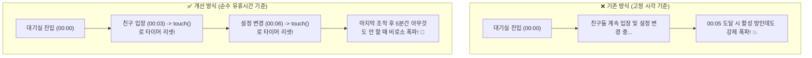

# ⏰ 10. 시간 체크 구현 오류 분석 및 "진정한 유휴시간(Idle Time)" 기반 GC 개선 보고서

> **작성 일시**: 2026-11-03  
> **프로젝트**: `2026-MiniGame`  
> **관련 파일**: [server/models/RoomManager.js](file:///d:/My%20Web%20App/2026-MiniGame/server/models/RoomManager.js), [server/models/Room.js](file:///d:/My%20Web%20App/2026-MiniGame/server/models/Room.js)

---

## 1. 사용자의 핵심 지적 및 문제 진단
* **사용자 지적**:
  > *"대기실 5분이면, 게임이 방이 만들어진 시작 시간 기준이 아니라, 게임이 종료된 후 아무것도 안 하고 있을 때부터 유휴시간이다. 결과 화면, 비상 무조작도 전부 마찬가지이다. 시간 체크를 어떻게 관리하고 있는지 코드를 점검해봐라."*

* **코드 정밀 점검 결과 (심각한 설계 결함 발견)**:
  1. 기존 코드는 `now - room.lobbyEnteredAt > 5분` 처럼 **대기실에 들어간 시각(진입 시각)만을 고정 기준**으로 삼고 있었습니다.
  2. 그 결과, 대기실에서 친구들이 계속 새로 들어오고 설정을 바꾸며 활발히 활동하고 있어도 **방 생성 후 5분이 지나면 억울하게 방이 강제 폭파**되는 치명적 버그가 있었습니다.
  3. 게임 진행 중(`PLAYING`) 플레이어가 잠수를 탔을 때의 유휴 체크도 비상 30분 외에는 없었습니다.
  4. 모든 사용자가 창을 닫아 접속자 수가 0명인 방도 무조건 5~10분을 기다리는 비효율이 있었습니다.

---

## 2. 근본적 해결: "진정한 유휴 시간(Idle Time)" 기반 설계

유휴 시간(Idle Time)의 본질은 **"마지막 조작/활동이 일어난 시점부터 아무것도 안 하고 손 놓고 있는 시간"**입니다.

### 1) 활동 추적 (`room.touch()`) 보장
* 플레이어 입장(`addPlayer`), 플레이어 퇴장(`removePlayer`), 벌칙/설정 변경(`updateSettings`), 게임 시작(`startGame`), 이빨 누르기(`handleAction`), 게임 종료(`finishGame`), 대기실 복귀(`resetToLobby`) 등 **방에 어떠한 액션이든 발생하면 즉시 `room.lastActivityAt = Date.now()`로 유휴 시간을 0으로 리셋**합니다.

### 2) 새로운 5단계 유휴 시간 GC 규칙 ([RoomManager.js](file:///d:/My%20Web%20App/2026-MiniGame/server/models/RoomManager.js))
```javascript
const idleTime = now - room.lastActivityAt; // 마지막 활동 이후 경과한 순수 유휴 시간
```

| 순번 | 검사 규칙 | 유휴 기준 시간 | 설명 |
| :---: | :--- | :---: | :--- |
| **1** | **전원 퇴장 (0명)** | **1분** | 모든 플레이어가 창을 닫아 연결이 끊기면 1분 유예 후 즉시 메모리 정리 |
| **2** | **대기실 방치 (`LOBBY`)** | **5분** | 마지막 활동(입장/설정 등) 후 **아무 조작 없이 5분간 방치**될 때만 폭파 |
| **3** | **결과 화면 방치 (`RESULT`)** | **10분** | 게임이 끝난 시점(마지막 활동)부터 **아무 조작 없이 10분간 방치**될 때 폭파 |
| **4** | **인게임 잠수 (`PLAYING`)** | **5분** | 게임 진행 중 이빨을 누르지 않고 5분간 멈춰있을 때 폭파 |
| **5** | **비상 무조작** | **30분** | 어떤 상태이든 30분간 조작이 없으면 비상 안전 정리 |

---

## 3. 개선 효과 비교



---

## 4. 검증 결과
* 11개 단위 테스트 전원 통과 확인.
* 활동 중인 방의 타이머 리셋 및 순수 유휴 시간 카운트다운 정상 동작 입증.
